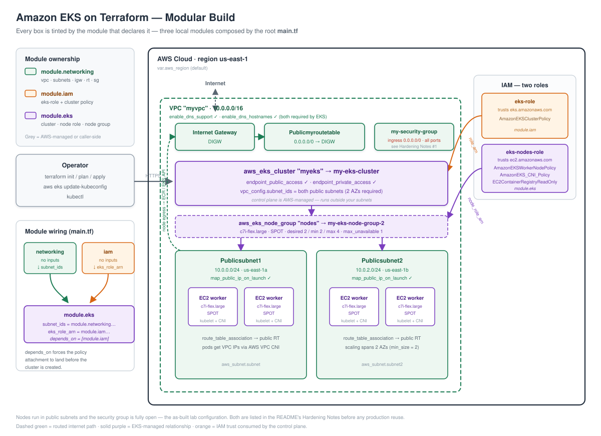
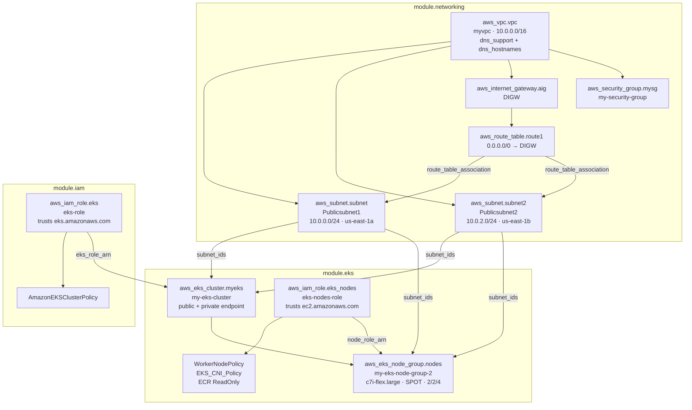

# Terraform EKS — End-to-End Kubernetes Cluster on AWS

> A modular, **Terraform-provisioned Amazon EKS cluster** built end to end from scratch — custom VPC across 2 Availability Zones, dedicated IAM roles for the control plane and the worker nodes, a managed EKS control plane, and a **SPOT** managed node group — all composed from three reusable local modules.

[](https://terraform.io)
[](https://registry.terraform.io/providers/hashicorp/aws/latest)
[](https://aws.amazon.com/eks/)
[](https://aws.amazon.com)
[](https://aws.amazon.com/ec2/spot/)

---

## Table of Contents

- [Overview](#overview)
- [Architecture](#architecture)
  - [Resource graph by module](#resource-graph-by-module)
- [Repository Structure](#repository-structure)
- [Prerequisites](#prerequisites)
- [Module Contract](#module-contract)
- [Build Flow](#build-flow)
  - [1. Provider and Region](#1-provider-and-region)
  - [2. Networking Module — VPC, Subnets, IGW, Routing, SG](#2-networking-module--vpc-subnets-igw-routing-sg)
  - [3. IAM Module — Control Plane Role](#3-iam-module--control-plane-role)
  - [4. EKS Module — Cluster](#4-eks-module--cluster)
  - [5. EKS Module — Node IAM Role](#5-eks-module--node-iam-role)
  - [6. EKS Module — Managed SPOT Node Group](#6-eks-module--managed-spot-node-group)
  - [7. Apply](#7-apply)
  - [8. Connect kubectl](#8-connect-kubectl)
- [Outputs](#outputs)
- [Verification](#verification)
- [Screenshots](#screenshots)
- [Hardening Notes](#hardening-notes)
- [Teardown](#teardown)
- [Common Workflow](#common-workflow)

---

## Overview

This repository provisions a working **Amazon EKS cluster** with Terraform — no `eksctl`, no community EKS module, no console clicking. Every resource is declared explicitly so the dependency chain (networking → IAM → control plane → node group) is visible in the code.

The root module wires three local modules together:

| Module | Responsibility | Key resources |
|--------|----------------|---------------|
| **`modules/networking`** | The network the cluster lives in | `aws_vpc`, 2 × `aws_subnet`, `aws_internet_gateway`, `aws_route_table` + associations, `aws_security_group` |
| **`modules/iam`** | Control-plane identity | `aws_iam_role` (`eks-role`) + `AmazonEKSClusterPolicy` attachment |
| **`modules/eks`** | The cluster and its compute | `aws_eks_cluster`, `aws_iam_role` (`eks-nodes-role`) + 3 policy attachments, `aws_eks_node_group` |

Data flows between them through outputs rather than hardcoded IDs: `networking` emits `subnet_ids`, `iam` emits `eks_role_arn`, and `eks` consumes both.

| Property | Value |
|----------|-------|
| Region | `us-east-1` (overridable via `aws_region`) |
| VPC CIDR | `10.0.0.0/16` |
| Availability Zones | `us-east-1a`, `us-east-1b` |
| Cluster name | `my-eks-cluster` |
| Node instance type | `c7i-flex.large` |
| Capacity type | `SPOT` |
| Node scaling | desired `2` · min `2` · max `4` |
| State backend | local (`terraform.tfstate`, not committed) |

---

## Architecture



Each box in the diagram is **tinted by the module that declares it** — green for `module.networking`, orange for `module.iam`, purple for `module.eks`, grey for anything AWS-managed or caller-side. Reading the colours shows the division of responsibility at a glance: the green layer is the network the cluster lives in, the orange box is the single role the control plane assumes, and everything purple is the cluster itself plus the compute that joins it.

**Provisioning flow:** `terraform apply` → the **networking** module builds the VPC, two public subnets (one per AZ), an Internet Gateway, a public route table with an association per subnet, and the security group → the **iam** module creates `eks-role` and attaches `AmazonEKSClusterPolicy` → the **eks** module creates the **EKS control plane** across both subnets, then a *separate* `eks-nodes-role` carrying the three node policies, then the **managed node group** that launches SPOT workers into those same subnets.

**Runtime flow:** `kubectl` → EKS API endpoint (public access enabled) → control plane → pods scheduled onto workers in `Publicsubnet1` / `Publicsubnet2`. Nodes reach the control plane and pull images from ECR through the Internet Gateway (dashed green path), since both subnets are public and `map_public_ip_on_launch` is set.

**Dependency ordering** is explicit — `module.eks` declares `depends_on = [module.iam]`, so the control-plane role *and its policy attachment* are fully in place before the cluster is created. Passing `eks_role_arn` alone is not enough: the ARN resolves as soon as the role exists, so without `depends_on` the cluster can be submitted while the policy attachment is still in flight and fail with an authorization error.

### Resource graph by module



The only edges crossing a module boundary are the three output values — `subnet_ids`, `eks_role_arn` and the implicit `depends_on`. Nothing references another module's resources directly, which is what makes each module replaceable on its own.

---

## Repository Structure

```
terraform-EKS/
├── README.md
├── .gitignore                       # excludes .terraform/ (648 MB) + all state files
├── provider.tf                      # terraform block + AWS provider (~> 5.0)
├── main.tf                          # root: wires networking → iam → eks
├── variable.tf                      # aws_region (default us-east-1)
├── output.tf                        # root outputs (currently empty — see Outputs)
├── .terraform.lock.hcl              # provider lock: hashicorp/aws 5.100.0
├── modules/
│   ├── networking/
│   │   ├── main.tf                  # VPC, 2 subnets, IGW, route table + assocs, SG
│   │   ├── variable.tf              # (no inputs — CIDRs/AZs are literals)
│   │   └── output.tf                # subnet_ids
│   ├── iam/
│   │   ├── main.tf                  # eks-role + AmazonEKSClusterPolicy
│   │   ├── variable.tf              # (no inputs)
│   │   └── output.tf                # eks_role_arn
│   └── eks/
│       ├── main.tf                  # cluster, node IAM role + 3 policies, node group
│       ├── variable.tf              # subnet_ids, eks_role_arn
│       └── output.tf                # cluster_name, cluster_endpoint, configure_kubectl
└── docs/
    └── images/
        ├── architecture/
        │   └── architecture-diagram.svg
        ├── cluster/                 # drop EKS console screenshots here
        ├── nodes/                   # drop node group / kubectl screenshots here
        └── outcome/                 # drop apply output / workload screenshots here
```

---

## Prerequisites

| Requirement | Notes |
|-------------|-------|
| **AWS account** | With permissions for VPC, EC2, EKS, IAM (role + policy attachment) |
| **Terraform** | `>= 1.5`; this build was run on **1.15.8** |
| **AWS credentials** | `aws configure`, `AWS_PROFILE`, or env vars — the provider takes no static keys |
| **AWS CLI v2** | Needed for `aws eks update-kubeconfig` |
| **kubectl** | Matching the cluster's Kubernetes minor version |
| **SPOT capacity** | `c7i-flex.large` SPOT capacity must be available in `us-east-1a`/`1b` |

> **Service quotas** — a fresh account can hit the default 5-VPC-per-region limit or an EKS cluster limit. Both surface as a plain `apply` failure, not a plan error.

---

## Module Contract

The three modules are coupled only through outputs — this is the whole interface:

```hcl
# main.tf
module "networking" {
  source = "./modules/networking"
}

module "eks" {
  source       = "./modules/eks"
  subnet_ids   = module.networking.subnet_ids   # ← list(string), both AZs
  eks_role_arn = module.iam.eks_role_arn        # ← control-plane role ARN
  depends_on   = [module.iam]                   # ← policy attached before cluster create
}

module "iam" {
  source = "./modules/iam"
}
```

| Producer | Output | Consumer | Input |
|----------|--------|----------|-------|
| `module.networking` | `subnet_ids` | `module.eks` | `subnet_ids` → cluster `vpc_config` **and** node group |
| `module.iam` | `eks_role_arn` | `module.eks` | `eks_role_arn` → cluster `role_arn` |

---

## Build Flow

### 1. Provider and Region

`provider.tf` pins the AWS provider to the 5.x line and reads the region from a variable, so the whole stack can be retargeted with a single `-var`:

```hcl
terraform {
  required_providers {
    aws = {
      source  = "hashicorp/aws"
      version = "~> 5.0"
    }
  }
}

provider "aws" {
  region = var.aws_region
}
```

```hcl
# variable.tf
variable "aws_region" {
  type    = string
  default = "us-east-1"
}
```

> The AZs in the networking module are **hardcoded** to `us-east-1a`/`us-east-1b`, so changing `aws_region` alone is not enough to move regions — see [Hardening Notes](#hardening-notes).

### 2. Networking Module — VPC, Subnets, IGW, Routing, SG

A `10.0.0.0/16` VPC with DNS support and DNS hostnames both enabled — **EKS requires both**, otherwise worker nodes cannot resolve the cluster endpoint and never join:

```hcl
resource "aws_vpc" "vpc" {
  cidr_block           = "10.0.0.0/16"
  enable_dns_support   = true
  enable_dns_hostnames = true
  instance_tenancy     = "default"
  tags = { Name = "myvpc" }
}
```

Two subnets in **two different AZs** — EKS will not create a cluster with subnets in a single AZ:

| Subnet | CIDR | AZ | Public IP on launch |
|--------|------|-----|---------------------|
| `Publicsubnet1` | `10.0.0.0/24` | `us-east-1a` | ✓ |
| `Publicsubnet2` | `10.0.2.0/24` | `us-east-1b` | ✓ |

An Internet Gateway (`DIGW`), a public route table sending `0.0.0.0/0` to it, and an association for **each** subnet:

```hcl
resource "aws_route_table" "route1" {
  vpc_id = aws_vpc.vpc.id
  route {
    cidr_block = "0.0.0.0/0"
    gateway_id = aws_internet_gateway.aig.id
  }
  tags = { Name = "Publicmyroutetable" }
}
```

Plus a security group `my-security-group` with all-traffic ingress and egress. The module exposes just the subnet IDs:

```hcl
output "subnet_ids" {
  value = [aws_subnet.subnet.id, aws_subnet.subnet2.id]
}
```

### 3. IAM Module — Control Plane Role

The EKS service needs a role it can assume to manage AWS resources on the cluster's behalf:

```hcl
resource "aws_iam_role" "eks" {
  name = "eks-role"
  assume_role_policy = jsonencode({
    Version = "2012-10-17"
    Statement = [{
      Action    = "sts:AssumeRole"
      Effect    = "Allow"
      Principal = { Service = "eks.amazonaws.com" }
    }]
  })
}

resource "aws_iam_role_policy_attachment" "eks_cluster_policy" {
  role       = aws_iam_role.eks.name
  policy_arn = "arn:aws:iam::aws:policy/AmazonEKSClusterPolicy"
}
```

The role ARN is the module's only output, consumed by the cluster.

### 4. EKS Module — Cluster

```hcl
resource "aws_eks_cluster" "myeks" {
  name     = "my-eks-cluster"
  role_arn = var.eks_role_arn

  vpc_config {
    subnet_ids              = var.subnet_ids
    endpoint_private_access = true
    endpoint_public_access  = true
  }

  tags = { Name = "my-eks-cluster" }
}
```

Both endpoint modes are on: **public** so `kubectl` works from a laptop, **private** so in-VPC traffic resolves to private addresses. This step is the long one — control-plane creation typically takes **10–15 minutes**.

### 5. EKS Module — Node IAM Role

Worker nodes assume a **separate** role (`ec2.amazonaws.com`, not `eks.amazonaws.com`) with three managed policies — all three are mandatory for a node to register and run pods:

| Policy | Why it's required |
|--------|-------------------|
| `AmazonEKSWorkerNodePolicy` | Lets the kubelet describe the cluster and register the node |
| `AmazonEKS_CNI_Policy` | Lets the VPC CNI attach ENIs / assign pod IPs |
| `AmazonEC2ContainerRegistryReadOnly` | Lets nodes pull images from ECR |

> Omit the CNI policy and nodes join but every pod stalls in `ContainerCreating` — the most common silent EKS bootstrap failure.

### 6. EKS Module — Managed SPOT Node Group

```hcl
resource "aws_eks_node_group" "nodes" {
  cluster_name    = aws_eks_cluster.myeks.name
  node_group_name = "my-eks-node-group-2"
  node_role_arn   = aws_iam_role.eks_nodes.arn
  subnet_ids      = var.subnet_ids
  instance_types  = ["c7i-flex.large"]
  capacity_type   = "SPOT"

  scaling_config {
    desired_size = 2
    max_size     = 4
    min_size     = 2
  }

  update_config {
    max_unavailable = 1
  }
}
```

`capacity_type = "SPOT"` cuts node cost substantially in exchange for interruption risk — appropriate for a lab or stateless workloads, and the reason `min_size = 2` spans two AZs. `max_unavailable = 1` keeps at least one node serving during a rolling node-group update.

### 7. Apply

```bash
terraform init      # downloads hashicorp/aws 5.100.0 per .terraform.lock.hcl
terraform fmt -recursive
terraform validate
terraform plan -out=tfplan
terraform apply tfplan
```

Expect roughly **15–20 minutes** end to end: VPC and IAM are near-instant, the control plane dominates, then the node group takes a few more minutes to report `ACTIVE`.

### 8. Connect kubectl

```bash
aws eks update-kubeconfig --name my-eks-cluster --region us-east-1
kubectl get nodes -o wide
```

Two nodes should reach `Ready`, one per AZ.

---

## Outputs

The **`eks` module** defines these:

| Output | Value |
|--------|-------|
| `cluster_name` | Cluster ID / name |
| `cluster_endpoint` | Kubernetes API server URL |
| `configure_kubectl` | Ready-to-paste `aws eks update-kubeconfig --name my-eks-cluster --region us-east-1` |

> **Note:** the **root** `output.tf` is currently empty, so these are not printed by `terraform output` at the root. Read them with `terraform output -json` against the module, or surface them by adding passthroughs to the root:
>
> ```hcl
> # output.tf (root)
> output "cluster_name"      { value = module.eks.cluster_name }
> output "cluster_endpoint"  { value = module.eks.cluster_endpoint }
> output "configure_kubectl" { value = module.eks.configure_kubectl }
> ```

---

## Verification

```bash
# Cluster reachable and healthy
aws eks describe-cluster --name my-eks-cluster --region us-east-1 \
  --query 'cluster.{status:status,version:version,endpoint:endpoint}'

# Node group active with the expected capacity type
aws eks describe-nodegroup --cluster-name my-eks-cluster \
  --nodegroup-name my-eks-node-group-2 --region us-east-1 \
  --query 'nodegroup.{status:status,capacity:capacityType,scaling:scalingConfig}'

# Nodes registered, one per AZ
kubectl get nodes -L topology.kubernetes.io/zone

# CNI healthy — proves AmazonEKS_CNI_Policy is attached correctly
kubectl -n kube-system get pods -l k8s-app=aws-node

# Smoke test a workload
kubectl create deployment nginx --image=nginx --replicas=2
kubectl get pods -o wide
kubectl delete deployment nginx
```

---

## Screenshots

Console and `kubectl` evidence for this build goes in `docs/images/`. The directories are in place with the expected filenames — drop the images in and uncomment the matching line below:

| Slot | Path | What it should show |
|------|------|---------------------|
| Cluster | `docs/images/cluster/eks-cluster.png` | EKS console — cluster `my-eks-cluster` **Active**, Kubernetes version, API endpoint access (public + private) |
| Node group | `docs/images/nodes/node-group.png` | Node group `my-eks-node-group-2` — SPOT, desired/min/max, both subnets |
| Nodes | `docs/images/nodes/kubectl-get-nodes.png` | `kubectl get nodes -o wide` — 2 nodes `Ready`, one per AZ |
| Apply | `docs/images/outcome/terraform-apply.png` | `terraform apply` complete, resources added |
| Workload | `docs/images/outcome/workload-running.png` | A test deployment scheduled across both nodes |

<!-- Uncomment each line once the corresponding image is committed:


-->

---

## Hardening Notes

This is a **working reference build**, optimised for a clear, readable dependency chain. Before reusing it for anything real:

| # | Finding | Fix |
|---|---------|-----|
| 1 | **Security group allows all ingress from `0.0.0.0/0`** (`protocol = "-1"`, ports `0–0`) | Restrict to the ports and sources actually needed; let EKS manage the cluster SG |
| 2 | **Worker nodes sit in public subnets** with `map_public_ip_on_launch = true` | Move nodes to private subnets + NAT Gateway; keep only the ALB/NLB public |
| 3 | **Public API endpoint open to the internet** | Add `public_access_cidrs` to `vpc_config`, or go private-only with a bastion/VPN |
| 4 | **AZs and CIDRs are hardcoded** | Drive them from `data "aws_availability_zones"` and variables so `aws_region` alone retargets the stack |
| 5 | **Local state** — no backend configured | Add an S3 backend with DynamoDB state locking before any team use |
| 6 | **No control-plane logging** | Add `enabled_cluster_log_types = ["api","audit","authenticator","controllerManager","scheduler"]` |
| 7 | **No subnet tags for load balancers** | Tag public subnets `kubernetes.io/role/elb = 1` (and private `.../internal-elb = 1`) so `Service type=LoadBalancer` and Ingress can provision |
| 8 | **No EKS addons declared** | Pin `vpc-cni`, `coredns`, `kube-proxy` via `aws_eks_addon` instead of relying on defaults |
| 9 | **SPOT-only capacity** | Fine for a lab; add an ON_DEMAND group for anything that must not be interrupted |
| 10 | Redundant duplicate `Action = "sts:AssumeRole"` key in `modules/iam/main.tf`'s assume-role policy | Harmless, but delete the second occurrence |

Also note `modules/networking/variable.tf` and `modules/iam/variable.tf` are intentionally empty — those modules take no inputs today, which is exactly what finding #4 would change.

---

## Teardown

EKS is expensive to leave running. Destroy in the right order — Terraform handles it, but delete any Kubernetes `LoadBalancer` services **first**, or their orphaned ELBs/ENIs will block VPC deletion:

```bash
kubectl delete svc --all --all-namespaces   # releases AWS-provisioned load balancers
terraform destroy
```

```bash
# Confirm nothing is left behind
aws eks list-clusters --region us-east-1
aws ec2 describe-vpcs --region us-east-1 --filters "Name=tag:Name,Values=myvpc"
```

---

## Common Workflow

```
1. terraform init  → provider hashicorp/aws 5.100.0 from the lock file
        │
        ▼
2. module.networking → VPC 10.0.0.0/16 + 2 public subnets (1a, 1b)
        │
        ▼
3.                  → Internet Gateway + public route table + 2 associations + SG
        │
        ▼
4. module.iam        → eks-role (assumed by eks.amazonaws.com) + AmazonEKSClusterPolicy
        │
        ▼
5. module.eks        → aws_eks_cluster "my-eks-cluster" in both subnets
   (depends_on iam)    public + private endpoint access  ~10-15 min
        │
        ▼
6.                  → eks-nodes-role (ec2.amazonaws.com) + WorkerNode + CNI + ECR policies
        │
        ▼
7.                  → managed node group, c7i-flex.large SPOT, desired 2 / min 2 / max 4
        │
        ▼
8. aws eks update-kubeconfig --name my-eks-cluster --region us-east-1
        │
        ▼
9. kubectl get nodes → 2 nodes Ready, one per AZ → schedule workloads
        │
        ▼
10. terraform destroy (delete LoadBalancer services first)
```

---

<div align="center">
  <sub>End-to-end <strong>Amazon EKS on Terraform</strong> — modular VPC, IAM, control plane and SPOT node group, composed from three local modules.</sub>
</div>
